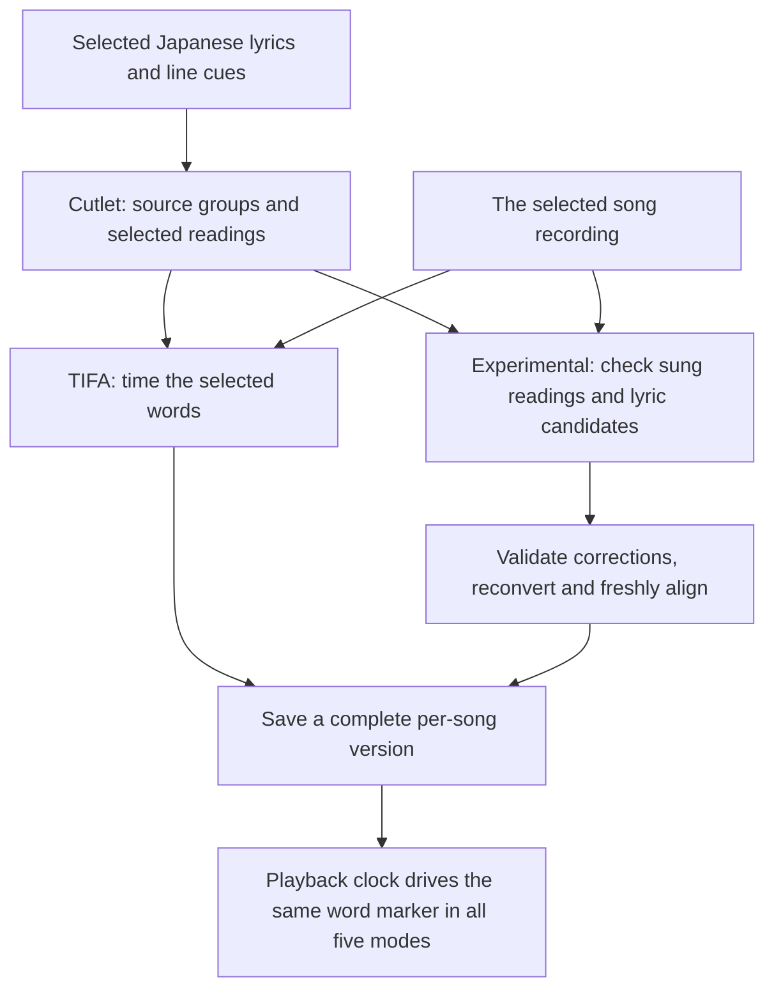

# Study view and saved song data

The study view follows the internal playback clock. Lyrics can display romaji,
hiragana above romaji, hiragana alone, katakana, or original Japanese with kanji and kana;
the selected mode persists after reopening. Changing mode performs no inference and
does not change a lyric version or saved timings.
Line timing remains available when individual word timing is missing. Timed words use
a distinct marker without changing font metrics or wrapping.

## Source identity and readings

Rust retains immutable provider/import snapshots. Occurrences have recording-specific
line timestamps; Japanese text and UTF-8 source spans identify reading corrections and
saved word timing. Multi-timestamp LRC lines expand into separate occurrences. Reading
corrections apply to identical repeated text within the song, while each occurrence's
timing stays independent.

The Python romanizer's version-2 protocol returns normalization mappings, contextual
hiragana/romaji/katakana spans and a `source-reading-v1` record per source group. The
record contains the selected written reading, rendered romaji, model target, optional
inflected dictionary pronunciation and its origin. Rust validates the record against
the source and display spans; Experimental validates targets before model use. Dictionary
pronunciation is absent for saved and curated sung readings. It must not reintroduce
the original kanji's dictionary reading after a correction.

All offsets are UTF-8 byte ranges into their named string. Python owns normalization,
correction application, grouping and display maps; Rust owns persistence and validates
request/signature identity. Katakana changes script without another dictionary lookup.
Both clients bound requests to 64 KiB and replies to 1 MiB: source-owned word records
can expand a valid short transcript beyond 64 KiB. Larger or incomplete replies still
fail, as do stale source/request identities and changed converter signatures.
Original Japanese displays the selected snapshot's exact text and raw word spans. If
ownership overlaps or is ambiguous, that view uses line highlighting while other views
retain usable word timings. Corrections are source-span edits; a
correction containing spaces remains one highlighted group. Reconversion preserves
original-text anchors and flags ambiguous reattachment rather than silently moving taps
or timings onto different text. Pinned snapshots protect edits from provider refreshes.

## Automatic alignment

**TIFA** runs the original local forced aligner against the current source snapshot.
**Experimental** first checks the sung readings, then times the resulting version.
It compares bounded dictionary alternatives with two MMS vocal views, rejects confident
contradictions using a separate singing phoneme recognizer, and can propose missing
readings from full-song blind Whisper transcription. Supported repairs store canonical
hiragana and derive romaji from it; all five display modes share those same source
anchors and newly aligned timing. The first recipe also supports bounded kana-only
lyric substitutions corroborated by vocal and original-mix transcriptions. It withholds
ambiguous changes and preserves explicit user corrections and earlier source versions.
The first recipe also protects spans carrying existing automatic reading overrides.
Re-evaluating those readings requires selecting an earlier uncorrected version; running
Experimental again on the corrected version only checks the remaining eligible spans.
Unsupported optional transcription candidates are withheld without aborting timing of
the selected lyrics. Source conversion, frozen-identity and protocol failures still abort
the job; input rejections are distinguished from stale or malformed helper replies.

The `vowel-extension-v1` update adds a narrow Experimental fallback for same-vowel
small-kana spellings such as `あぁ` when TIFA's normal pronunciation converter rejects
them. It retains the original text, source spans and display reading. Only nominated
unsupported words may gain timing; existing neighbors can move only through the bounded
repair policy, with independent MMS support and phrase coherence. Valid digraphs such as
`ふぁ` are preserved. TIFA's original action remains unchanged. Experimental result
fingerprints now include the recipe identity as well as pinned model assets, while older
saved versions continue to load without reconversion or inference.

The `singing-word-recovery-v1` stage fills remaining gaps using freshly observed
TIFA endpoints checked against the existing RomajiASR singing model on Kim vocals.
It first checks the selected Japanese pronunciation, then two fixed CMU-to-Japanese
phonetic hypotheses for English words sung with Japanese pronunciations. These aliases
are acoustic inputs only: they never rewrite source text, hiragana or romaji. Unknown
phones remain unsupported. Models are reused sequentially, with no additional weights.

A recovered word needs a complete positive-similarity TIFA path with at least 0.90
token agreement, at least 0.45 singing-model probability, both endpoints within
150 ms, at least 80 ms duration, and the existing phrase-coherence gate. Every missing
or unsupported source word still counts in that gate's denominator. The stage preserves
every interval retained by the earlier Experimental stages and rejects overlaps; it
never trims, spreads or copies timestamps. Each repeated occurrence uses its own audio
window. This timing-only addition leaves the sung-reading repair protocol unchanged.
Its [evaluation](study-completeness-evaluation.md) separates coverage from correctness.

The `spoken-pronunciation-v1` fallback follows those stages. For an eligible dictionary
reading, it tries the inflected spoken kana on the same source group and obtains fresh
TIFA intervals checked against the singing model. It uses the same confidence, endpoint,
duration and phrase gates above, preserves existing intervals and changes no displayed
reading. Corrected or unavailable readings do not receive a dictionary shadow. Model
adapters stay separate: TIFA uses kana/phonetic targets, MMS uses supported Latin labels,
and RomajiASR uses singing phones. Display mode never chooses model input. The
[representation evaluation](study-representation-evaluation.md) records compatibility,
paired pronunciation trials and native replay results.

The [accuracy experiments](study-accuracy-evaluation.md) record why broader pronunciation
scoring, neighboring context, repeat localization and an English speech verifier remain
offline. Their research commands are explicit; hooks do not download models or run them.

Rust sends the frozen source/edit revision, delay, recording/model identities and protected
spans. Python returns provisional patches and fresh alignment; Rust validates the patches,
reconverts them and verifies exact timing targets before saving a complete result. No
partially corrected version is applied. Completed results cannot overwrite a later edit,
and reopening restores all five views and timing without running models again.

Models run sequentially. TIFA downloads about 151 MB; Experimental downloads about
5.3 GB of additional pinned weights once, including Whisper large-v3 and the singing
phoneme recognizer. The standalone bundle contains the inference runtimes. A package
check launches the bundled romanizer from Experimental with no developer environment.

The normal controls are the persisted display-mode selector, Follow, and the separate
TIFA/Experimental actions. Options contains imports, provider refresh, recording choices,
delay, source previews, saved-version restore and sung-correction details. Reading repair
and word timing require no manual work. A job finishing after the selected lyrics or
delay changed asks for a retry rather than promising that selecting an old version can
reattach a result whose saved revision no longer matches.

See [reading evaluation](study-reading-evaluation.md) for measured limits.

Candidate repairs must pass source identity, interval bounds and acoustic consistency
checks. Existing baseline intervals are retained unless a tested repair rule authorizes
a replacement. All results record their engine/provenance and remain selectable as
saved versions for that song.

Missing intervals are not interpolated. A coverage count means retained model intervals,
not proven audible accuracy. Listen to sustained notes, fast passages and verse changes
when evaluating a new model or policy.

## Local files

The macOS bundle identity is `io.github.Anny0nn.RomajiPlayer`. App directories and
Keychain namespaces retain that identity across builds. Study data and downloaded
models remain in the user's application data, independently of the source checkout.
Moving or recloning the repository does not move or clear saved song timings.

On macOS, durable documents are stored in
`~/Library/Application Support/io.github.Anny0nn.RomajiPlayer/study/`. Model files use
the adjacent `models/` directory. Backing up `study/` retains source snapshots, readings
and word intervals; removing download caches does not remove those documents. In-progress
analysis is cancellable, and the app should remain open until completion is reported.

The build uses local `.env` settings for public Spotify client configuration; account
grants use protected credential storage. Model files download separately and are
verified against pinned manifests. Neither credentials nor audio/lyric caches are part
of the public git history.
